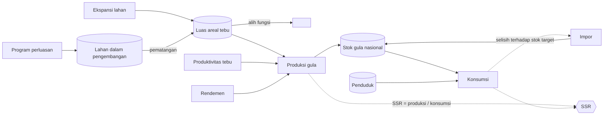

<div align="center">

# 🍬 Simulasi Sistem Dinamik Ketersediaan Gula Nasional

**Produksi, konsumsi, dan ketergantungan impor dengan skenario peningkatan produktivitas, rendemen, dan perluasan areal tebu**


**UTS Pemodelan dan Simulasi, Semester 5, Tahun 2025/2026**

🔗 **Aplikasi web:** `https://sd-gula-nasionalgit-irsfyd7cbs2qpwrpq5ku98.streamlit.app/

</div>

---

## 👤 Penulis

|                 |                        |
| --------------- | ---------------------- |
| **Nama**        | Soni Moch Leviansyah   |
| **NIM**         | 301240030              |
| **Mata kuliah** | Pemodelan dan Simulasi |

---

## 📌 Ringkasan

Indonesia masih mengimpor sebagian besar kebutuhan gulanya. Proyek ini membangun model **System Dynamics** (stock-flow) untuk melihat bagaimana produksi, konsumsi, dan impor gula nasional bergerak dari waktu ke waktu, lalu menguji seberapa jauh tiga intervensi kebijakan dapat menaikkan **Self-Sufficiency Ratio (SSR)**:

1. peningkatan produktivitas tebu,
2. peningkatan rendemen,
3. perluasan areal tebu.

Model dikalibrasi dengan data 2014-2024, divalidasi dengan MAPE dan uji kondisi ekstrem, lalu dijalankan sebagai aplikasi web interaktif.

##  Fitur Aplikasi

-  **Skenario kustom**: atur target produktivitas, rendemen, tambahan areal, tingkat realisasi, dan periode intervensi lewat slider.
-  **Perbandingan 6 skenario**: baseline, produktivitas, rendemen, perluasan, kombinasi, dan roadmap Perpres 40/2023.
-  **Validasi model**: MAPE terhadap data aktual dan uji kondisi ekstrem.
-  **Analisis sensitivitas**: diagram tornado untuk melihat parameter paling berpengaruh.
-  **Metode dan data**: struktur model dan tabel data tersedia langsung di aplikasi.

##  Struktur Model



| Stok                         | Persamaan                             |
| ---------------------------- | ------------------------------------- |
| Luas areal tebu _A_          | `dA/dt = g_exp·A + D/τ − g_conv·A`    |
| Lahan dalam pengembangan _D_ | `dD/dt = program_perluasan − D/τ`     |
| Stok gula nasional _S_       | `dS/dt = produksi + impor − konsumsi` |
| Penduduk _P_                 | `dP/dt = g_pop·P`                     |

Variabel bantu:

- `produksi = A × produktivitas tebu × rendemen`
- `konsumsi = P × c(t)`, dengan konsumsi per kapita `c(t)` menuju titik jenuh
- `impor = max(0, konsumsi − produksi + (S_target − S)/τ_s)` (loop penyeimbang)
- `SSR = produksi / konsumsi`

Simulasi memakai metode Euler dengan langkah 0,25 tahun.

##  Hasil

### Validasi (data 2014-2024)

| Variabel   | MAPE |
| ---------- | ---- |
| Luas areal | 4,7% |
| Produksi   | 5,2% |
| Konsumsi   | 4,7% |
| Impor      | 7,5% |
| SSR        | 6,8% |

Pembanding eksternal: Outlook Tebu 2025 memperkirakan produksi 2025 sebesar 2,59 juta ton, sedangkan model menghasilkan 2,63 juta ton (selisih +1,4%).

### Skenario (intervensi 2026-2030)

| Skenario                                   | SSR 2030 | SSR 2035 |
| ------------------------------------------ | -------- | -------- |
| Baseline (tren saat ini)                   | 35%      | 37%      |
| Peningkatan produktivitas (70 → 85 ton/ha) | 42%      | 45%      |
| Peningkatan rendemen (→ 10%)               | 49%      | 51%      |
| Perluasan areal (+350 ribu ha)             | 51%      | 60%      |
| Kombinasi tiga intervensi                  | 87%      | 101%     |
| Roadmap Perpres 40/2023 penuh              | 140%     | 171%     |

> Model tidak memasukkan ekspor, sehingga SSR di atas 100% berarti surplus teoretis, bukan prediksi realistis.

##  Cara Menjalankan

### Lokal (VS Code)

```bash
python -m venv .venv
.venv\Scripts\activate          # Mac/Linux: source .venv/bin/activate
pip install -r requirements.txt
streamlit run app.py
```

Aplikasi terbuka di `http://localhost:8501`.

### Notebook

Buka `SD_Gula_Nasional_UTS.ipynb` di Google Colab atau VS Code (ekstensi Jupyter), lalu jalankan semua cell dari atas ke bawah.

##  Struktur Repositori

```
.
├── app.py                        # Aplikasi web Streamlit
├── sd_model.py                   # Model System Dynamics, kalibrasi, validasi, sensitivitas
├── data_gula.csv                 # Data tahunan 2014-2024
├── requirements.txt              # Dependensi
├── SD_Gula_Nasional_UTS.ipynb    # Notebook (Colab/VS Code)
└── README.md
```

##  Sumber Data

- Pusat Data dan Sistem Informasi Pertanian, _Outlook Tebu 2025_, Kementerian Pertanian (luas panen dan produksi gula hablur, data Ditjen Perkebunan).
- Badan Pusat Statistik (impor gula dan jumlah penduduk).

##  Asumsi dan Keterbatasan

- Alih fungsi lahan (2%/tahun), produktivitas tebu awal (70 ton/ha), dan stok penyangga (sekitar 1,8 bulan konsumsi) adalah **asumsi**, bukan hasil kalibrasi.
- Pertumbuhan neto areal baseline 2,07%/tahun mengikuti rata-rata 2016-2025 pada Outlook Tebu 2025.
- Konsumsi didefinisikan sebagai produksi + impor (_apparent consumption_), sehingga angka SSR tidak langsung sebanding dengan penelitian yang hanya menghitung konsumsi rumah tangga.
- Kalibrasi memakai seluruh data 2014-2024, sehingga MAPE bersifat _in-sample_.
- Beberapa nilai impor dan jumlah penduduk perlu diverifikasi ulang terhadap tabel resmi BPS (lihat kolom `catatan` pada `data_gula.csv`).

##  Referensi

1. Wirdianto, E., Ananda, D., Jonrinaldi, & Wisnel. (2025). Proposed sugar self-sufficiency policy in Indonesia using system dynamics. _E3S Web of Conferences, 677_, 10002. https://doi.org/10.1051/e3sconf/202567710002
2. Wanggai, C. M., & Moeis, A. O. (2026). Policy scenarios in the system dynamics model of Indonesia's sugar supply and demand for the national food self-sufficiency strategy. _Proceedings of the 3rd GCC International Conference on IEOM_. https://doi.org/10.46254/GC03.20250485
3. Puspitosari, R. R., & Surono, S. (2020). Analisis faktor-faktor yang mempengaruhi konsumsi dan produksi gula menuju swasembada gula 2019. _Jurnal Kebijakan Ekonomi, 15_(2), Art. 10. https://scholarhub.ui.ac.id/jke/vol15/iss2/10
4. Pusat Data dan Sistem Informasi Pertanian. (2025). _Outlook Tebu 2025_. Kementerian Pertanian.
5. Peraturan Presiden Nomor 40 Tahun 2023 tentang Percepatan Swasembada Gula Nasional dan Penyediaan Bioetanol sebagai Bahan Bakar Nabati.
6. Bala, B. K., Arshad, F. M., & Noh, K. M. (2017). _System Dynamics: Modelling and Simulation_. Springer.

---

<div align="center">

Dibuat oleh **Soni Moch Leviansyah** (NIM 301240030)

</div>
